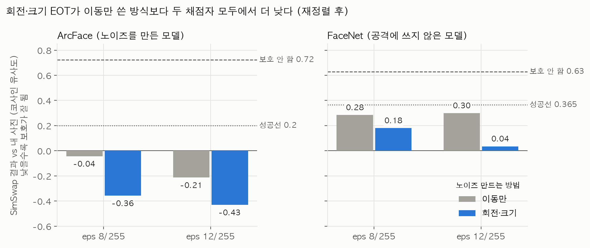
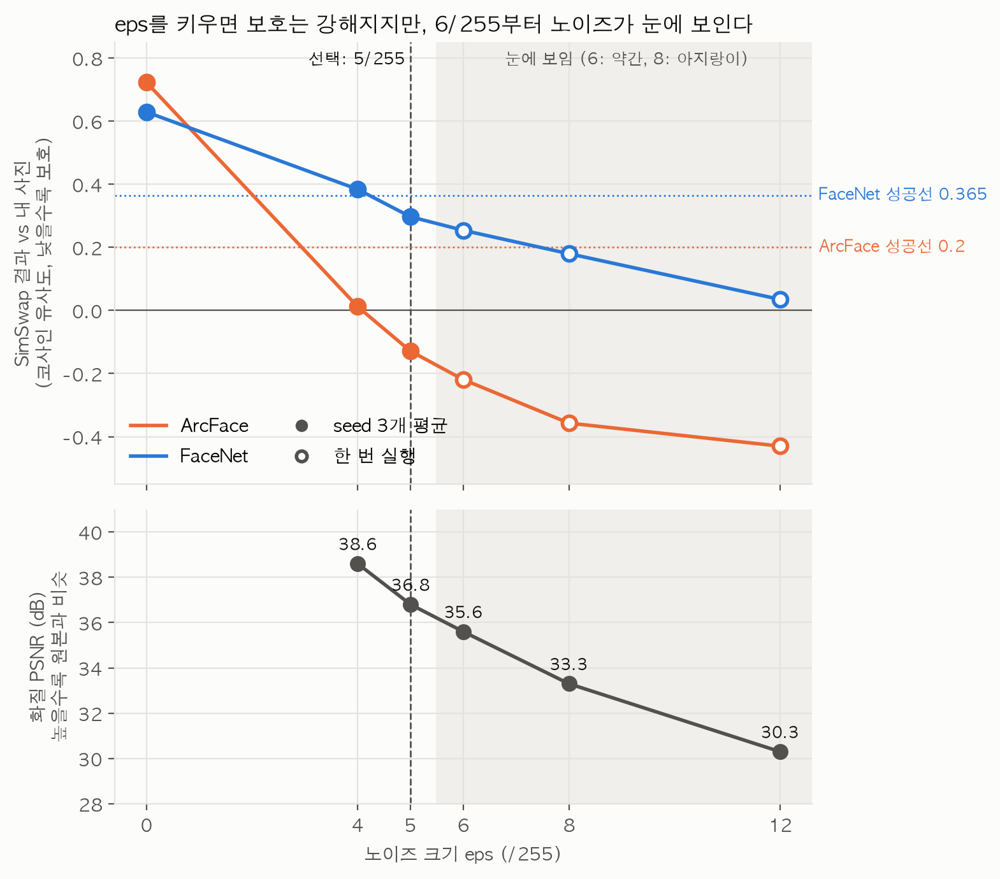
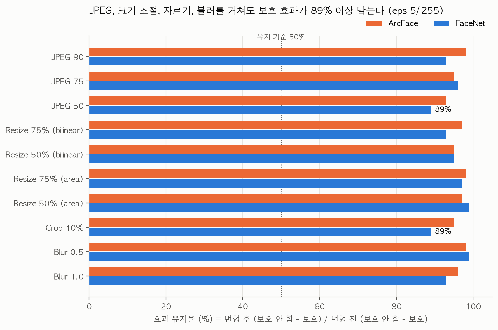

# Week 6 — Face swap 보호 효과 측정 및 견고성 실험

> **결론:** 눈에 거의 안 보이는 노이즈(eps 5/255, 회전·크기 EOT)로 SimSwap을 막았다. ArcFace 0.72 → -0.13, FaceNet 0.63 → 0.29 (seed 3개 평균). JPEG·크기 조절·자르기·블러 후에도 효과의 89% 이상이 남는다.

## 목표
SimSwap에 대한 보호 효과가 현실의 변형(재정렬, JPEG, 크기 조절 등)을 거쳐도 유지되는지 확인하고, 최종 노이즈 설정을 정한다.

## 최종 설정과 결정 과정
| 항목 | 결정 | 이유 |
|---|---|---|
| 노이즈 만드는 방법 | 회전·크기 EOT (변형 4개) | 이동만 쓴 Week 5 방식보다 두 평가 모델 모두에서 확실히 낮아짐 |
| 노이즈 크기 | **eps 5/255** | 8/255는 숫자로 충분했지만 눈에 아지랑이처럼 보임. 눈에 안 보이는 것 중 효과가 가장 좋음 |
| 반복 횟수 | steps 30 | 50과 차이가 흔들림 폭보다 작음 |
| 결과 | 4장 평균 ArcFace -0.129, FaceNet 0.297 (둘 다 성공) | seed 3개 평균 |

그래프 코드: `experiments/week6_plots.py`. 노트북: `notebooks/simswap_robustness.ipynb`

## 핵심 개념
- **회전·크기 EOT:** SimSwap의 재정렬은 얼굴을 1픽셀 옮길 뿐 아니라 살짝 회전하고 크기도 바꾼다. 반복마다 무작위 변형 4개(회전 ±3도, 크기 ±5%, 이동 ±2픽셀, 1개는 변형 없음)를 뽑아 평균 유사도를 낮춘다. 미분 가능한 `affine_grid`, `grid_sample`을 써서 기울기가 원래 픽셀까지 전달된다.
- **seed:** 랜덤 출발과 무작위 변형 때문에 같은 설정이라도 결과가 매번 다르다. seed를 고정하면 재현되고, 결론은 여러 seed의 평균으로 낸다.
- **SSIM:** 작은 영역마다 밝기·대비·구조를 비교하는 화질 지표다. PSNR보다 사람 눈에 가깝고, 1에 가까울수록 원본과 비슷하다.

## 결과
모든 결과는 (B) 재정렬 기준, SimSwap 결과 vs 내 사진이다. 판정선은 Week 5와 같다 (ArcFace 성공 < 0.2, FaceNet 성공 < 0.365).

### 1. 회전·크기 EOT (한 번 실행)
| eps | 방식 | ArcFace | FaceNet |
|---|---|---|---|
| 8 | 이동만 (Week 5) | -0.09 ~ 0.03 | 3장 성공, 1장 부분 |
| 8 | **회전·크기·이동** | **-0.43 ~ -0.29** | **4장 성공** |
| 12 | 이동만 | -0.29 ~ -0.16 | 4장 성공 |
| 12 | 회전·크기·이동 | -0.51 ~ -0.38 | 4장 성공 |

- 16개 비교가 모두 같은 방향으로 좋아졌고, 화질은 같다. Week 5에서 재정렬 후 효과가 줄었던 원인은 회전·크기 변화였다. → 채택

### 2. eps와 화질 (한 번 실행)
| eps | ArcFace | FaceNet | PSNR | SSIM | 눈으로 |
|---|---|---|---|---|---|
| 4 | 4장 성공 | 2장 성공, 2장 부분 | 38.6dB | 0.90 ~ 0.96 | 거의 안 보임 |
| 8 | 4장 성공 | 4장 성공 | 33.3dB | 0.80 ~ 0.89 | **아지랑이처럼 보임** |
| 12 | 4장 성공 | 4장 성공 | 30.3dB | 0.70 ~ 0.80 | 보임 |

- 미리 정한 숫자 기준으로는 8/255가 통과했지만, 눈에 보여서 탈락했다. 기준에 화질 조건이 빠져 있었다.
- 6/255도 약간 보여서 탈락했다. 4와 5를 seed 3개로 비교했다.
- 한 번만 돌린 결과는 같은 설정에서도 0.24까지 흔들렸다. 설정끼리의 차이보다 커서 seed 반복이 필요했다.

### 3. 반복 실행 (seed 3개 평균)
| 설정 | ArcFace 4장 평균 | FaceNet 4장 평균 | FaceNet 판정 | PSNR |
|---|---|---|---|---|
| 보호 안 함 | 0.72 | 0.629 | - | - |
| eps 4, 변형 4개 | 0.012 | 0.384 | a_4 부분 | 38.2 ~ 38.7dB |
| eps 4, 변형 8개 | -0.017 | 0.363 | a_4 부분 | 38.2 ~ 38.7dB |
| **eps 5, 변형 4개** | **-0.129** | **0.297** | a_4 부분 (0.384) | 36.7 ~ 37.0dB |

- eps 5가 두 모델 모두에서 가장 좋다.
- 변형 8개는 계산이 2배인데 이득(0.02)이 흔들림 폭(표준편차 0.04 ~ 0.10)보다 작다.
- a_4는 어떤 설정에서도 FaceNet 기준 부분 보호다. 이 사진의 특성으로 본다.
- 판정선은 결과를 본 뒤 바꾸지 않았다.

### 4. 변형 견고성 (eps 5, seed 3개)
보호 안 한 사진에도 같은 변형을 적용해 나란히 비교했다. 유지율 = (그 변형에서 보호 안 함 - 보호) / (변형 없을 때 보호 안 함 - 보호)

| 변형 | 현실 상황 | ArcFace 유지율 | FaceNet 유지율 |
|---|---|---|---|
| JPEG 90 / 75 / 50 | SNS 업로드, 메신저 | 98 / 95 / 93% | 93 / 96 / **89%** |
| Resize 75% / 50% (bilinear, area) | 썸네일 | 95 ~ 98% | 93 ~ 99% |
| Crop 10% | 프로필 자르기 | 95% | **89%** |
| Blur sigma 0.5 / 1.0 | 필터 | 98 / 96% | 99 / 93% |

- 11가지 모두 두 모델에서 성공을 유지했다. 가장 약한 경우도 효과의 89%가 남았다.
- 보호 안 한 사진은 변형 후에도 그대로다(ArcFace 0.71 ~ 0.72). 보호 사진이 낮게 나온 것은 노이즈가 살아남았기 때문이다.
- 가장 약한 변형은 JPEG 50(노이즈 일부가 지워짐)과 Crop(재정렬이 크게 달라짐)이다.

사진별 숫자: `results/week6/`

## 한계
- a_4는 FaceNet 기준 부분 보호다(변형 후 0.375 ~ 0.423).
- 얼굴만 잘라낸 224×224 사진으로 실험했다. 실제 SNS는 사진 전체를 압축하고 줄인다.
- 변형은 한 번에 하나씩만 적용했다. 실제로는 여러 변형이 겹친다.
- 여러 모델 함께 공격, 모멘텀은 다음으로 넘겼다 (Week 7에서 ensemble 진행).

## 깨달은 점
- 숫자 기준만으로는 부족하다. 눈으로 확인해서 8/255를 탈락시켰다. 기준을 정할 때 화질 조건도 함께 넣어야 한다.
- 한 번 돌린 결과는 흔들림이 차이보다 클 수 있다. seed를 고정하고 반복해서 평균으로 판단해야 한다.
- 변형 견고성은 보호 안 한 사진과 나란히 비교해야, 노이즈가 살아남은 것과 변형 자체의 영향을 구분할 수 있다.

## 자료
- SimSwap: https://github.com/neuralchen/SimSwap (CC BY-NC 4.0, 학술·비상업 용도)
- EOT: Athalye et al., ICML 2018 / `affine_grid`, `grid_sample`: PyTorch 공식 문서
